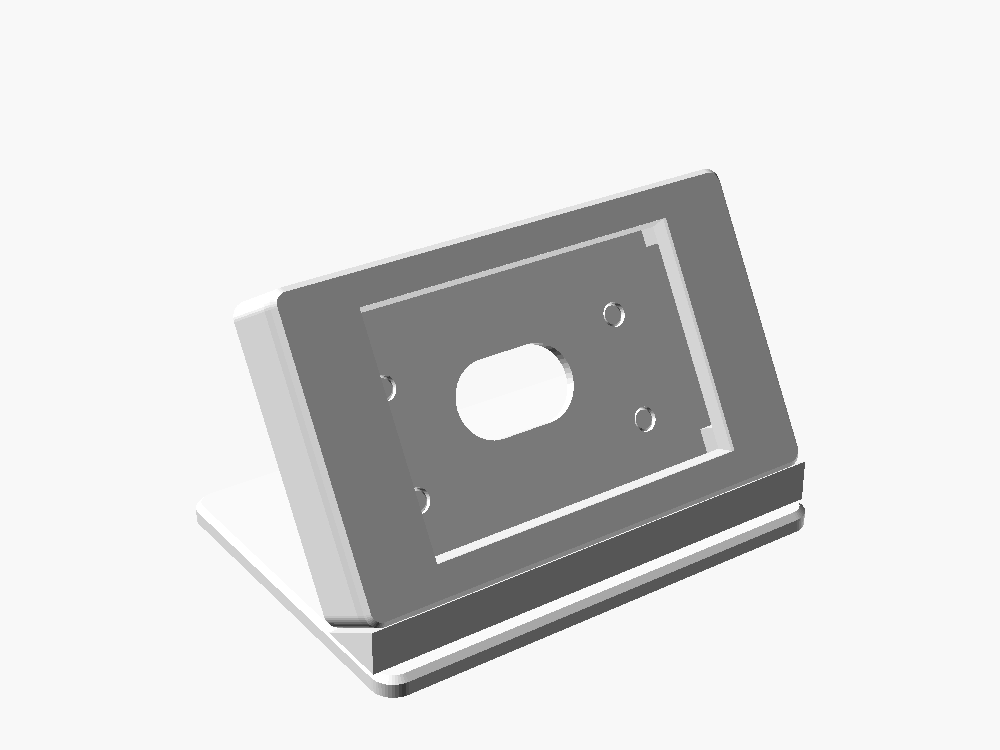
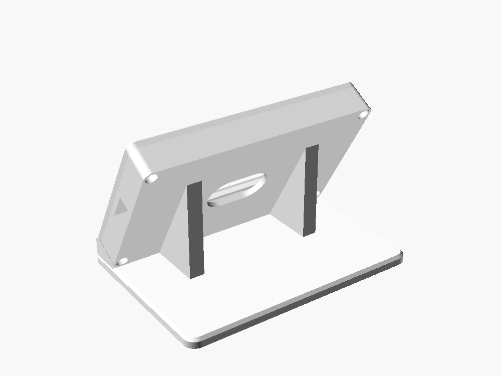

# Nightstand stand

A desk stand for the Hosyond 4.0" ESP32-32E panel, styled like the Stream Deck stand: a flat base,
two triangular fins, and the screen in landscape leaning back at 60°. The board's RGB LED shines
through a window in the back and lights up the white base behind the screen.

| Front | Back |
|---|---|
|  |  |

## Parts

| File | Print orientation | Notes |
|---|---|---|
| `stl/holder.stl` | back plate on the bed | Tray the board drops into. USB-C notch in the side, LED window in the back, 4 corner pads the PCB rests on. |
| `stl/bezel.stl` | face down | Front frame. Screwed on from the back, so no screws show on the front. |
| `stl/stand.stl` | as exported (base on the bed) | Base, front ledge, and two fins with locating pegs. |

White PLA, 0.2 mm layers, 3 walls, 15-20% infill. No supports needed.

**Hardware:** 4 × M3 × 12 screws (pan or socket head), self-tapping straight into the bezel.
Stick your rubber pads anywhere on the flat bottom of the base.

## Before you print: measure your board

The outline and screen sizes come from LCDwiki, but I couldn't get their drawing for
where the port, LED and lit area sit, so those are parameters with safe guesses.
The USB-C port is on the right and the LED is dead centre on the back, and the model is set up for that.
Measure the rest with calipers, set them at the top of `nightstand_stand.scad`, and re-export the STLs
(OpenSCAD: set `part`, F6, File → Export → STL).

Measure everything **looking at the screen**, from the board's **bottom-left corner**, screen in landscape.

| Parameter | What to measure | Default |
|---|---|---|
| `active_x`, `active_y` | Board edge to the edge of the **lit** area (turn the screen on, show a white page). | Centred |
| `usb_y` | Height of the USB-C port's centre from the bottom edge (`usb_side` is set to `right`). | Centred |
| `rear_clear` | Height of the tallest part on the back of the PCB (usually the USB-C port or a JST plug). | 9 mm |

The holder and stand are only sized from the board outline, so if you just want to test the fit
and the look, they're fine to print with the defaults.

## Assembly

1. Drop the board into the holder, screen up. It rests on the four corner pads.
2. Put the bezel on and screw it down from the back with the 4 M3 screws.
3. Set the assembled screen on the stand: the bottom edge sits on the front ledge and the
   four pegs on the fins go into the holes in the back. It isn't screwed down, so you can lift it
   off to get at the USB port or the BOOT/RESET buttons. A dab of glue or double-sided tape on
   the pegs makes it permanent.
4. A right-angle USB-C cable keeps the side tidy.

## Tweaking

- `tilt`: screen angle from horizontal (60° matches the Stream Deck).
- `rear_extend`: how far the base reaches behind the screen (the glow area).
- `wall`: bezel border width.
- If the board rattles, put a strip of thin foam tape on the corner pads.
- If the bezel presses on the edge of the touch panel and causes stray touches, increase
  `window_margin` or add 0.2-0.3 mm to `stack_front`.
